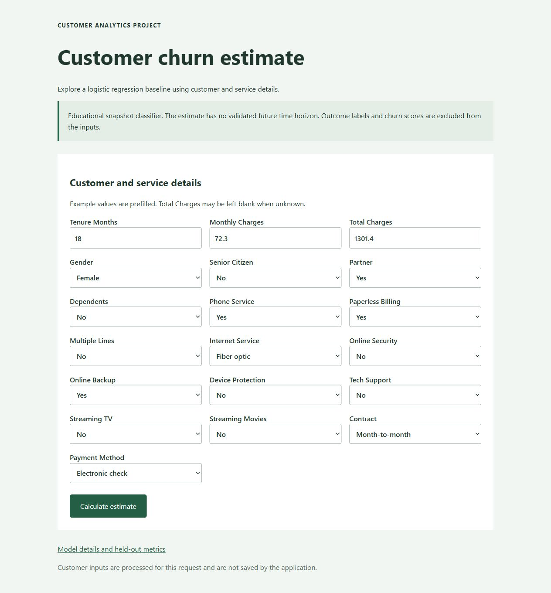

# Customer Churn Prediction

[](https://github.com/TSobees/Customer-Churn-Prediction-/actions/workflows/checks.yml)

A runnable logistic regression project with a responsive Flask interface, a JSON
endpoint and an optional FastAPI adapter. The preprocessing and classifier are
saved together, so both APIs use exactly the same input contract.

**Educational snapshot classification.** No validated future churn horizon or
production readiness is claimed. The revised model excludes IDs and churn outcome
fields, including `Churn Value`, `Churn Reason` and `Churn Score`.



## Quick start

Use Python 3.12 or 3.13 from the repository root:

```sh
python -m venv .venv
# Windows: .venv\Scripts\activate
# Linux/macOS: source .venv/bin/activate
python -m pip install -r requirements.txt
python app.py
```

Open <http://127.0.0.1:5000>. The form is prefilled with fictional example inputs.
Every model feature is explicit; unknown categories, inconsistent service options,
missing required fields and nonfinite numbers produce clear errors. Total Charges
may be unknown and is then imputed by the fitted training pipeline. Inputs are not saved.

## JSON API

`POST /predict` accepts the exact field names in [the example request](examples/customer.json):

```sh
curl -X POST http://127.0.0.1:5000/predict -H "Content-Type: application/json" --data-binary @examples/customer.json
```

The response includes `prediction`, `label`, `probability`, `threshold` and scope.
`GET /health` checks model readiness; `GET /api/model-info` exposes aggregate test
metrics and provenance. These endpoints do not expose the dataset's customer rows.

For FastAPI and interactive API docs:

```sh
python -m pip install -r requirements-api.txt
python -m uvicorn main:app --host 127.0.0.1
```

Open <http://127.0.0.1:8000/docs>. Both adapters use the same inference function.

## Train and inspect

```sh
python -m churn.train
python -m churn.train --data data/Telco_customer_churn.csv --output-dir outputs/another-model
```

The default writes `models/churn_pipeline.joblib` and `models/metadata.json`. Numeric
preprocessing and one-hot encoding fit only on training data. Evaluation uses a
fixed stratified 80/20 split and a 0.5 decision threshold. The test is not temporal
or external validation. See [model card](docs/MODEL_CARD.md), [measured evaluation](docs/EVALUATION.md) and the
[walkthrough notebook](notebooks/Churn_walkthrough.ipynb).

## Layout

```text
churn/                  Shared schema, pipeline training and inference
app.py, main.py         Flask and optional FastAPI adapters
models/                 Compact trained pipeline and measured metadata
templates/, static/     Responsive web interface using local CSS
data/                   Original CSV and its source notes
examples/               Valid fictional JSON request
notebooks/              Reproducible walkthrough without personal file paths
tests/                  Input, inference and cross-API regression checks
docs/                   Model contract and limitations
```

Generated Python caches and obsolete root-level pickle/column files have been
removed. They remain in Git history. **API compatibility change:** clients must
send the new explicit schema; `Churn_Value`, `Churn_Score` and the former five-field
request are no longer accepted, because outcomes cannot be prediction inputs.

## Tests

```sh
python -m pip install -r requirements-dev.txt
python -m unittest discover -s tests -v
```

CI compiles Python, checks both APIs and retrains the baseline on Python 3.12 and
3.13. Test metrics are measured from the supplied snapshot, not a business guarantee.

## Attribution and license

Author: Sobanjo Oluwatosin. The original project cited
[Allan Ouko's churn application](https://github.com/AllanOuko/customer-churn-prediction-application).
That attribution is retained. AI assisted this revision's shared pipeline, input
validation, interface, tests and documentation. Code: [MIT](LICENSE.txt).
Dataset provenance and third-party rights: [data notes](data/README.md).
