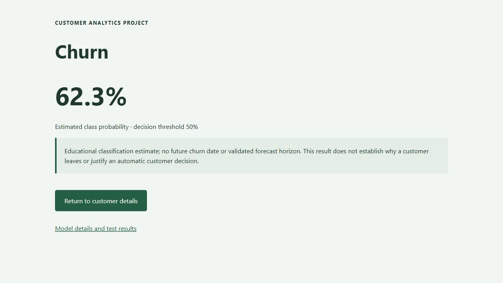

# Measured churn baseline evaluation

Fixed stratified 80/20 holdout, random state 42. Decision threshold 0.5.

| Metric | Held-out result |
| --- | --- |
| Accuracy | 80.2% |
| Precision | 64.4% |
| Recall | 57.0% |
| F1 | 60.4% |
| Roc Auc | 84.9% |
| Average Precision | 64.5% |
| Test Prevalence | 26.5% |

Test rows: 1409. Training rows: 5634.

Confusion matrix: TN 917, FP 118, FN 161, TP 213.

These measured results concern the supplied snapshot only. The split is not temporal or external.
Outcome columns and identifiers are excluded; earlier metrics from the leaked input set are not a valid comparison.
Probability calibration, fairness and effects of retention interventions remain unvalidated.

Exact inputs, versions and source fingerprint are in [model metadata](../models/metadata.json).

